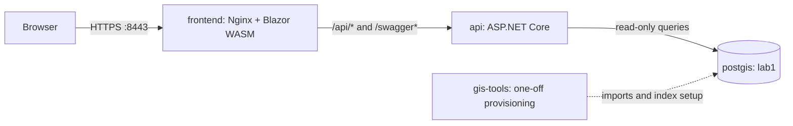

# Local Docker deployment

GeoSearch runs as a single-origin HTTPS application using Docker Compose. Nginx serves the published Blazor WebAssembly client and forwards API requests to ASP.NET Core. The API reads the imported OpenStreetMap dataset from PostGIS. Images are built locally; no image registry or host-side .NET/GDAL installation is required.

This deployment is intended for a single Docker host and local acceptance testing. For day-to-day development, use the [development environment](../docs/development.md) instead.

## Runtime topology



Only `frontend` publishes a host port, bound to `127.0.0.1:8443` by default. The API listens on `api:8080` inside the Docker network; PostGIS is reachable only on the internal `database` network. Nginx serves client routes and static resources directly, forwarding `/api/*` and `/swagger*` without changing their paths. Swagger is available through that route only when the **API runtime** uses the `Development` environment.

The `gis-tools` service runs only during provisioning. It downloads the pinned Geofabrik inputs, imports them into PostGIS, builds the search index, and configures the restricted `geosearch_reader` database login. The browser never connects directly to PostGIS or to a third-party geocoder. For the search request lifecycle and database ownership rules, see [architecture](../docs/architecture.md).

## Deploy for local acceptance testing

The recommended environment is **Docker-outside-of-Docker (DooD)**: use the Docker CLI from the VS Code devcontainer to operate the Docker daemon on the host. Running the same commands directly on the Docker host is also supported. The daemon host needs Docker Engine with Compose, enough disk space for the imported GIS dataset, and a browser for testing. The invoking shell needs Bash, OpenSSL, and `tar` for TLS import; the build containers provide .NET and GDAL.

Start Docker and, if using DooD, open the [devcontainer](../.devcontainer/README.md). Verify that the Docker CLI can access the daemon:

```sh
docker info --format 'Docker server: {{.ServerVersion}}'
docker compose version
```

From the **repository root**, perform the following setup. These commands create independent deployment storage and do not modify the devcontainer's PostGIS database.

1. Create the ignored deployment configuration and set distinct, strong values for `POSTGIS_PASSWORD` and `GEOSEARCH_READER_PASSWORD`:

   ```sh
   cp deploy/.env.example deploy/.env
   chmod 600 deploy/.env
   # Edit deploy/.env to supply both passwords.
   ```

2. Supply `deploy/certs/fullchain.pem` and `deploy/certs/privkey.pem`. For a temporary localhost certificate, run:

   ```sh
   ./deploy/scripts/local-cert.sh
   ./deploy/scripts/load-cert.sh
   ```

   `local-cert.sh` refuses to overwrite existing certificates. If you provide an existing certificate and private key instead, run only `load-cert.sh`. The import checks that the files match and copies them into the Docker-managed `tls-certs` volume, readable by the unprivileged Nginx process. No private key is baked into an image. A self-signed certificate requires explicit browser/OS trust for acceptance testing.

3. Prepare the dataset and the restricted database login:

   ```sh
   ./deploy/scripts/provision.sh
   ```

   The script starts PostGIS, downloads and validates the pinned Niedersachsen datasets, imports the Hannover subset, builds the SQL search index, creates the reader login, and runs search/reverse smoke queries. GIS inputs are cached in a separate named volume; interrupted downloads can resume. Initial provisioning requires Internet access, several gigabytes of disk space, and additional time for download/import. **Rerunning provisioning replaces imported data and rebuilds the index**; do not run it for routine image updates.

4. Build and start the application:

   ```sh
   cd deploy
   docker compose config --quiet
   docker compose up -d --build
   docker compose ps
   ```

Open **https://localhost:8443/** from a browser on the **Docker daemon host**. The published address uses the port configured by `GEOSEARCH_HTTPS_PORT` if changed. Check both static asset loading (including `/_framework/` files) and an actual search response through Nginx. From a shell on the Docker host:

```sh
curl -kfsS https://127.0.0.1:8443/api/health
curl -kfsS 'https://127.0.0.1:8443/api/search?q=Limmerstr%2012%20Hannover&limit=5'
```

The `-k` flag skips certificate validation for these **command-line smoke checks only**. A browser must trust the certificate to test location permissions reliably; the self-signed certificate is not automatically trusted. The complete [acceptance procedure](../docs/validation.md) covers search results, map behavior, geolocation, attribution, and the required evidence.

## Configuration and storage

The Git-ignored `deploy/.env` supplies Compose interpolation values. The environment file configures the **deployment project**, not the devcontainer's development stack. Its settings are:

| Setting | Used for | Default |
| --- | --- | --- |
| `POSTGIS_PASSWORD` | PostGIS administrator and one-off GIS import tools | Required |
| `GEOSEARCH_READER_PASSWORD` | Restricted GIS reader, supplied to the API | Required |
| `GEOSEARCH_HTTPS_BIND_ADDRESS` | Host interface publishing Nginx | `127.0.0.1` |
| `GEOSEARCH_HTTPS_PORT` | Host HTTPS port | `8443` |
| `GEOSEARCH_API_ENVIRONMENT` | API runtime environment; `Development` enables Swagger | `Production` |
| `DOTNET_BUILD_CONFIGURATION` | API image build configuration | `Release` |

The API container receives `ASPNETCORE_ENVIRONMENT` from `GEOSEARCH_API_ENVIRONMENT`, rather than inheriting the devcontainer's `ASPNETCORE_ENVIRONMENT=Development`. Build configuration and runtime environment are independent: a Debug build does not enable Swagger. Docker Compose gives variables exported in the invoking shell precedence over `.env`, so do not export a conflicting `GEOSEARCH_API_ENVIRONMENT` value. Leave `DOTNET_ENVIRONMENT` unset in the API container to avoid another runtime override.

The deployment uses three Docker-managed volumes: `postgis-data` for the database, `gis-data` for downloaded inputs, and `tls-certs` for the imported TLS material. Secrets must not be committed or included in images. The frontend uses the browser origin as its API base address, so no production `Api:BaseUrl` override or cross-origin browser configuration is needed.

### Docker-outside-of-Docker boundaries

DooD shares the host Docker daemon, **not** the devcontainer filesystem or network namespace. Image build contexts are sent to the daemon by the Docker client, but bind-mounted paths are resolved on the daemon host. Consequently, this deployment transfers TLS files through Docker's input stream and stores GIS downloads in named volumes; neither `deploy/certs/` nor `lab/data/` is bind-mounted from `/workspace`.

Similarly, `localhost` inside the devcontainer may not be the Docker host. Test the published HTTPS port from the host browser or terminal; do not expose the port publicly to work around container networking. The Compose project name is `geosearch`, separate from the `geospatial-search` development project, so their networks and volumes are independent.

Docker socket access gives the devcontainer extensive control of the host daemon. This model is suitable only for trusted local development and acceptance testing, not untrusted workloads or a hardened public deployment.

## Operate the stack

Run these commands from `deploy/`:

```sh
docker compose ps
docker compose logs -f frontend api postgis
docker compose up -d --build        # Rebuild and restart the application
docker compose down                 # Stop services; preserve volumes
```

For a renewed TLS certificate, update the files in `deploy/certs/`, run `./deploy/scripts/load-cert.sh` from the repository root, and restart `frontend`. For an intentional dataset refresh, run `./deploy/scripts/provision.sh` again; it is not part of normal application startup.

**Do not run `docker compose down -v` unless you intend to delete all deployment volumes**, including the imported dataset, database, and TLS material. `docker compose down` alone retains them. The deployment keeps its own GIS cache, distinct from `lab/data` in the development stack.

For troubleshooting, inspect `docker compose logs` first. A failure to open `/run/tls/fullchain.pem` indicates missing or inaccessible imported TLS material; rerun the certificate importer. If the provisioning preflight reports an unwritable GIS volume, inspect `docker volume inspect geosearch_gis-data` and available Docker host disk space. Do not change ownership of the source checkout to match the `gis-tools` container user.

To confirm the API's effective runtime environment, run:

```sh
docker compose exec api printenv ASPNETCORE_ENVIRONMENT
```

`Production` is the default. For local Swagger testing, set `GEOSEARCH_API_ENVIRONMENT=Development` in `deploy/.env` and run `docker compose up -d --force-recreate api`. Swagger UI is then available at `/swagger`, with its OpenAPI JSON at `/swagger/v1/swagger.json`. Revert to `Production` for normal operation and recreate the API; requests to those endpoints should then return 404.

Nginx does not record access logs because nearby-search URLs can contain device coordinates. Missing static framework assets return 404 rather than the SPA entrypoint; Blazor's published import map resolves fingerprinted .NET 10 JavaScript modules. The stack has no automated certificate renewal, off-host database backup, monitoring, or public-service hardening. It is intended for local, single-host use.
