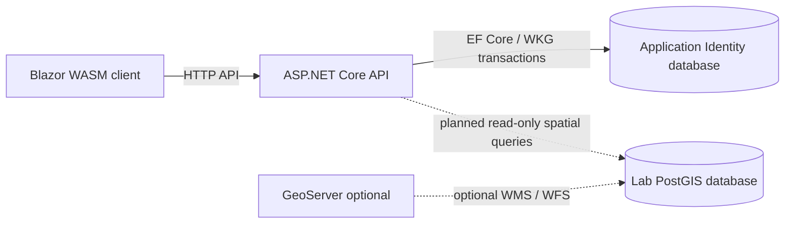

# GeoSearch architecture

GeoSearch is a Blazor WebAssembly frontend and a thin ASP.NET Core API over the instructor's Hannover PostGIS dataset. The application will expose local address, place, and nearby search through GeoJSON, with MapLibre rendering those results in the browser. The current implementation includes the solution foundation, Identity services, and a styled map placeholder; the GIS API and interactive map are designed but not yet implemented.

## System boundaries

The following diagram describes the **target GIS data flow**, together with the implemented Identity boundary:

The client handles UI state, browser location permissions, and eventually MapLibre rendering. It communicates with the application API, never directly with PostGIS or a third-party geocoder. A future map adapter will own MapLibre-specific representations and translate GeoJSON into map sources and layers, keeping mapping-library types out of shared HTTP contracts.

The API owns HTTP validation, authentication, and the GeoJSON contract. The planned search adapter invokes the instructor's `search.search(q, lim)` and `search.reverse(lon, lat, radius, lim)` functions and uses parameterized PostGIS queries for nearby and categories. The instructor's ranking logic remains authoritative; geometry and distances are computed by PostGIS. GeoJSON coordinates use longitude followed by latitude, and nearby distances use meters.

## Database ownership

GeoSearch uses distinct PostgreSQL databases with different ownership models:

- **`lab1` (instructor-owned):** contains the imported `osm` schema, `search.search_index` materialized view, and supplied search functions. The application accesses these through a read-only search context. The `just` recipes in `lab/` own import and index lifecycle; EF Core does not migrate this database.
- **`geosearch_auth` (application-owned):** contains ASP.NET Core Identity and hashed refresh-token records in the `app_auth` schema. EF Core migrations own its schema, and WKG transactions coordinate Identity writes.

This separation allows the search API to remain independent of authentication. Lab 2's read-only search features require no user account, so future GIS endpoints should remain accessible without Identity unless an extension introduces a concrete authorization requirement.

GeoServer is an optional independent WMS/WFS publisher over the PostGIS dataset, not an intermediary for application search requests. A local basemap or tile server, if added, will be a separate deployment concern.

## Planned GIS HTTP contract

The lab specifies `/api/search`, `/api/reverse`, `/api/nearby`, and `/api/categories`. Search, reverse, and nearby return a GeoJSON `FeatureCollection` with snapshot metadata, OSM attribution, and point features; categories may return a JSON array. Parameter validation produces HTTP 400 for invalid input. The API will expose the supplied PostGIS search semantics without copying or mutating the imported OSM data.

The client will debounce text search, cancel superseded requests, and acquire device coordinates only after explicit user action. If permission is declined, the UI will provide a map-center fallback. Location data is transient: neither the client nor API should persist user coordinates or log reverse/nearby query strings.

These routes, map interactions, and privacy behavior are **design requirements**, not currently implemented features.

## Authentication and session lifecycle

The implemented authentication subsystem uses ASP.NET Core Identity and two-minute JWT access tokens held only in browser memory. Login also issues a rotating opaque refresh token in a Secure, HttpOnly, SameSite=Strict, host-only cookie. Only its SHA-256 hash is stored in the Identity database; successive refresh tokens belong to a token family.

Refresh rotation and logout are cookie-authenticated operations. The browser first requests an antiforgery token and then submits it in the `X-CSRF-TOKEN` header. The API's endpoint-metadata middleware validates that token for marked endpoints; ordinary bearer-token API requests do not require antiforgery validation. The browser coordinates refresh operations across tabs with the Web Locks API.

Rotation detects consumed or invalidated tokens and revokes their family; logout revokes the active family, and password changes revoke all existing refresh sessions before issuing a replacement. WKG transaction scopes cover the application-owned Identity writes. Access JWTs are not blacklisted and remain valid until their short expiry, including after a refresh session is revoked. Identity applies per-account failed-login lockout; the API has no application-level request rate limiter.

The maintenance service periodically deletes records whose expiry is older than a configurable retention period (30 days by default), including consumed history. Unexpired tokens remain stored so that a replay can identify its family. Once a record is pruned, reuse still fails authentication, but the deleted token can no longer identify a family for revocation. The service operates only on the Identity database and retries future cleanup after a database failure.

Public registration is disabled. A development bootstrap account can be provisioned for testing the application shell; the lab's GIS features are independent of this optional account system.

## Quality and deployment boundaries

The lab requires a median search latency under 300 ms over ten supplied fixture queries. This must be measured against an imported PostGIS dataset; compilation and authentication unit tests cannot establish GIS performance. The future browser and spatial integration tests must also cover GeoJSON correctness, distance units, permission failures, and cancellation of stale requests.

The intended application deployment is a single browser origin with `/api/*` routed to ASP.NET Core over HTTPS. The repository currently uses separate development origins for the API and client. Production TLS termination, key management, forwarded-header trust, monitoring, and any reverse-proxy traffic limits are not supplied by this initial scaffold.

The modular monolith keeps a small deployment boundary around one authoritative spatial database. EF Core is reserved for application-owned Identity models; invoking the provided SQL functions directly preserves the existing search behavior. The MapLibre integration is isolated in the client so the mapping library can evolve without changing the HTTP contracts.
