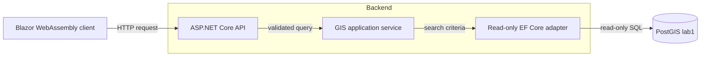

# GeoSearch architecture

GeoSearch provides address and place search, reverse geocoding, and nearby-point-of-interest queries over an OpenStreetMap-derived snapshot of Hannover. The Blazor WebAssembly client owns browser interactions; the ASP.NET Core API validates requests and defines the HTTP contract; PostGIS executes text search, spatial filtering, and ranking. The browser does not access the database or a third-party geocoder.

## Search request lifecycle

The diagram shows the logical read path, independent of how the client and API are hosted. GeoServer, when enabled for the lab, reads the same PostGIS database independently and does not participate in API requests.



Controllers validate search terms, coordinates, radii, and result limits and return the lab's `{"error":"…"}` response for invalid requests. The GIS application service maps database rows into point-only GeoJSON. The read adapter queries three typed EF Core table-valued functions: `search.api_search`, `search.api_reverse`, and `search.api_nearby`. These application-owned SQL adapters expose a consistent row shape without duplicating geospatial algorithms in .NET.

`search.api_search` delegates to the instructor's search function for full-text/fuzzy ranking. `search.api_reverse` uses the instructor's reverse function and looks up the matching indexed document to recover location and category metadata. `search.api_nearby` filters indexed POIs by category and geographic radius, calculates distances in metres, and sorts by distance. Categories and snapshot metadata come from narrow read-only projections. All GeoJSON point coordinates are `[longitude, latitude]` in EPSG:4326.

The client is responsible for search interactions, map state, displaying results, and requesting device coordinates only in response to user actions. MapLibre-specific representations belong to the frontend; the shared HTTP contract remains independent of the map renderer. The current client has a browser shell and map placeholder, while interactive search and geolocation remain to be implemented.

## Data ownership and access

The `lab1` PostGIS database contains the imported `osm` schema, the `search.search_index` materialized view, and the search/reverse functions provided by the lab. The additional `search.api_*` functions provide the application-specific read surface. The `lab/` SQL and `just` recipes own importing, index creation, and refresh. **EF Core does not migrate the GIS schema.**

The server uses WKG source-generated discovery for explicitly marked, keyless GIS read projections. EF Core disables tracking and rejects `SaveChanges`; each query runs within a WKG read-only, auto-rollback `ReadCommitted` transaction. These are application-level safeguards. PostgreSQL enforces access through a separate `geosearch_reader` account with only the required read and execute privileges. The administrative `lab1` role is reserved for imports and index maintenance, not for normal API requests.

Every GIS endpoint is public and read-only. The server obtains its database credentials from private runtime configuration; the browser never receives them. The optional GeoServer instance can publish WMS/WFS layers from PostGIS but is not an intermediary for search requests.

## GIS HTTP contract

The API provides four endpoints. Search and spatial parameters are supplied in the query string; latitude and longitude use WGS84 degrees, and radii and reported distances are in metres.

| Endpoint | Parameters | Response |
| --- | --- | --- |
| `GET /api/search` | Required free-text `q` (1–200 characters); `limit` 1–20, default 10 | Ranked address, place, street and POI matches |
| `GET /api/reverse` | Required `lat`, `lon`; `radius` > 0 and ≤ 1000, default 250 | Nearest address, POI or street |
| `GET /api/nearby` | Required `lat`, `lon`; `radius` > 0 and ≤ 2000, default 500; optional exact category; `limit` 1–20, default 20 | POIs ordered by distance, then stable ID |
| `GET /api/categories` | None | Sorted JSON array of categories present in the index |

The first three endpoints return a GeoJSON `FeatureCollection`, with a dataset snapshot ID, OpenStreetMap attribution, and point features. Properties include `id`, `name`, `label`, `type`, `category`, nullable `score`, and nullable `distance_m`. Search provides the score; reverse and nearby provide distance. Empty collections preserve the dataset snapshot. Latitude must fall within −90..90 and longitude within −180..180. Invalid requests, including malformed parameter types, return HTTP 400 with `{"error":"…"}`.

OpenAPI and Swagger UI are served in the API's `Development` runtime environment only. The [deployment guide](../deploy/README.md) explains how that environment is configured independently of the devcontainer.

## Privacy and quality boundaries

The browser sends device coordinates only for a user-initiated location-sensitive request. The API does not persist coordinates and suppresses request-start logging that would otherwise include coordinate-bearing query strings. GIS responses are marked non-cacheable. Browser location permission handling, the map-centre fallback, and visible attribution are frontend responsibilities.

The lab targets search responses below 300 ms on the Hannover dataset. Spatial SQL correctness, ranking quality, and latency must be measured against populated PostGIS; in-memory unit tests cannot establish them. See the [validation guide](validation.md) and [submission evidence record](lab-handoff.md).

A potential performance boundary concerns nearby searches. `search.api_nearby` applies `ST_DWithin(s.display_pt::geography, ...)`, while the existing `search_index_pt` GiST index covers `display_pt` as a `geometry` column. That index does not directly support the geography expression used for metre-based filtering. If profiling shows a bottleneck **and** modifications to the instructor-owned schema are permitted, a partial geography expression index could be evaluated:

```sql
CREATE INDEX search_index_poi_geog
    ON search.search_index USING gist ((display_pt::geography))
    WHERE type = 'poi';
```

This index is **not installed**. Compare execution plans and timings with `EXPLAIN (ANALYZE, BUFFERS)`, including index size and refresh cost, before deciding whether it is worthwhile. Since `s05-search-index` recreates the materialized view, any approved index must be incorporated into that rebuild workflow.

## Runtime deployment boundary

A local Docker Compose deployment serves the published client and API behind one HTTPS origin. Nginx serves static Blazor files and forwards `/api/*` to an ASP.NET Core container over a private Docker network. The API uses a separate network to query PostGIS. Importing the geodata and maintaining the search index remain one-off operations, separate from normal application startup. See [deployment](../deploy/README.md) for concrete configuration and operations.
