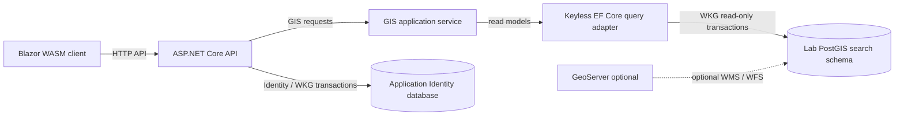

# GeoSearch architecture

GeoSearch is a Blazor WebAssembly frontend and a thin ASP.NET Core API over the instructor's Hannover PostGIS dataset. The API exposes address, place, reverse-geocoding, and nearby search through GeoJSON. The Blazor client has an authentication-enabled shell and a styled map placeholder; interactive MapLibre and geolocation behavior remain frontend work.

## System boundaries

The following diagram shows the API read path and the independent Identity data path:

The client handles UI state, browser location permissions, and eventually MapLibre rendering. It communicates with the application API, never directly with PostGIS or a third-party geocoder. A future map adapter will own MapLibre-specific representations and translate GeoJSON into map sources and layers, keeping mapping-library types out of shared HTTP contracts.

The API controller validates query parameters and maps expected failures to `{"error":"…"}` responses. Its application service maps read-model results into point-only GeoJSON. The database adapter queries three typed EF Core table-valued function roots: `search.api_search`, `search.api_reverse`, and `search.api_nearby`. These application-owned SQL adapters return the same keyless row shape. Search and reverse delegate to the unchanged instructor functions; reverse joins the nearest result back to the indexed document to recover its location, category, and snapshot. Nearby evaluates category filtering and geography-based distance selection/sorting inside PostGIS. Categories and empty-result snapshot metadata use LINQ over narrowly mapped read-only views. Full-text/fuzzy ranking remains in PostGIS, and distances use metres. GeoJSON coordinates are always `[longitude, latitude]` in EPSG:4326.

## Database ownership

GeoSearch uses distinct PostgreSQL databases with different ownership models:

- **`lab1` (instructor-owned):** contains the imported `osm` schema, `search.search_index` materialized view, and supplied search/reverse functions. Additive application-owned SQL query functions provide a stable read projection without modifying the instructor's ranking logic. The `just` recipes in `lab/` own import and index lifecycle; EF Core does not migrate this database.
- **`geosearch_auth` (application-owned):** contains ASP.NET Core Identity and hashed refresh-token records in the `app_auth` schema. EF Core migrations own its schema, and WKG transactions coordinate Identity writes.

Identity and GIS models are discovered by separate WKG source-generated model loaders, filtered using context-specific marker attributes. Identity remains writable and migratable; GIS models are explicitly mapped, keyless projections with no migrations, disabled change tracking, and a `SaveChanges` guard. Each GIS query runs in a WKG read-only, auto-rollback, ReadCommitted transaction; this does not replace PostgreSQL access control. The privileged import role remains separate from the `geosearch_reader` login, provisioned with [the database recipe](development.md#configure-the-server). Imports, index refreshes, schema changes, and creation of the API read functions remain administrative operations.

This separation allows the search API to remain independent of authentication. Lab 2's read-only search features require no user account, the four GIS endpoints are anonymous. A future extension would need a concrete authorization requirement before changing that boundary.

GeoServer is an optional independent WMS/WFS publisher over the PostGIS dataset, not an intermediary for application search requests. A local basemap or tile server, if added, will be a separate deployment concern.

## GIS HTTP contract

The four anonymous read-only endpoints are `/api/search`, `/api/reverse`, `/api/nearby`, and `/api/categories`. Search, reverse, and nearby use query-string parameters; categories takes none. `/api/search` accepts one free-text `q` (1–200 characters) and a limit of 1–20 (default 10). `/api/reverse` requires latitude/longitude and accepts a radius above zero and up to 1,000 m (default 250 m); it returns the nearest address, POI, or street. `/api/nearby` requires latitude/longitude and accepts a radius up to 2,000 m (default 500 m), optional exact German category label, and a limit of 1–20 (default 20); POIs are ordered by metre distance, then stable ID. `/api/categories` returns a sorted JSON array of category labels actually present among the indexed POIs.

The three geospatial query endpoints return a GeoJSON `FeatureCollection` containing a snapshot ID, OSM attribution, and point features with `id`, `name`, `label`, `type`, `category`, nullable `score`, and nullable `distance_m`. Search sets the score; reverse and nearby set distance. Empty collections preserve the snapshot metadata. The snapshot comes from the materialized view and falls back to import metadata when the view contains no documents. Inputs must use WGS84 degrees (`lat` from −90 to 90, `lon` from −180 to 180); invalid requests return HTTP 400 with `{"error":"…"}`, including type conversion failures. The server exposes the OpenAPI document at `/swagger/v1/swagger.json` in Development.

The browser does not send device coordinates until the user requests a location-sensitive operation. To avoid accidental leakage, HTTP request-start logging is filtered and neither the read adapter nor the application service stores the coordinates. API responses are marked no-store. The UI must still implement location permissions, debounce, map-centre fallback, and results/markers.

## Authentication and session lifecycle

The implemented authentication subsystem uses ASP.NET Core Identity and two-minute JWT access tokens held only in browser memory. Login also issues a rotating opaque refresh token in a Secure, HttpOnly, SameSite=Strict, host-only cookie. Only its SHA-256 hash is stored in the Identity database; successive refresh tokens belong to a token family.

Refresh rotation and logout are cookie-authenticated operations. The browser first requests an antiforgery token and then submits it in the `X-CSRF-TOKEN` header. The API's endpoint-metadata middleware validates that token for marked endpoints; ordinary bearer-token API requests do not require antiforgery validation. The browser coordinates refresh operations across tabs with the Web Locks API.

Rotation detects consumed or invalidated tokens and revokes their family; logout revokes the active family, and password changes revoke all existing refresh sessions before issuing a replacement. WKG transaction scopes cover the application-owned Identity writes. Access JWTs are not blacklisted and remain valid until their short expiry, including after a refresh session is revoked. Identity applies per-account failed-login lockout; the API has no application-level request rate limiter.

The maintenance service periodically deletes records whose expiry is older than a configurable retention period (30 days by default), including consumed history. Unexpired tokens remain stored so that a replay can identify its family. Once a record is pruned, reuse still fails authentication, but the deleted token can no longer identify a family for revocation. The service operates only on the Identity database and retries future cleanup after a database failure.

Public registration is disabled. A development bootstrap account can be provisioned for testing the application shell; the lab's GIS features are independent of this optional account system.

## Quality and deployment boundaries

The lab requires search latency below 300 ms for the Hannover extract. The provided SQL handles full-text/fuzzy ranking, but this threshold has not been measured here because the imported PostGIS dataset is unavailable in the offline workspace. Contract and model unit tests do not establish spatial SQL correctness, execution latency, database privilege enforcement, or transaction behavior against PostgreSQL. Those require the real database, and browser geolocation/cancellation tests require the frontend.

The intended application deployment is a single browser origin with `/api/*` routed to ASP.NET Core over HTTPS. The repository currently uses separate development origins for the API and client. Production TLS termination, key management, forwarded-header trust, monitoring, and any reverse-proxy traffic limits are not supplied by this initial scaffold.

The modular monolith keeps a small deployment boundary around one authoritative spatial database. EF Core maps Identity's writable application entities and, separately, keyless GIS query results; its GIS context never owns the instructor's schema. The MapLibre integration belongs in the client so the mapping library can evolve independently of the HTTP contract.
