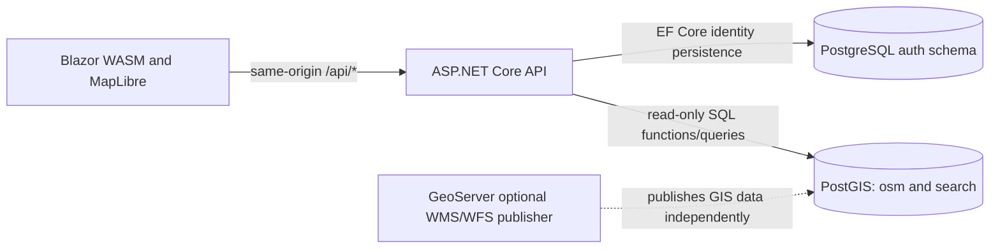

# GeoSearch architecture

GeoSearch is a Blazor WebAssembly search client over a thin ASP.NET Core API and the database-first Hannover PostGIS snapshot supplied by Software Architectures Lab 2. The purpose of the application is to make address, place and POI search accessible through a unified GeoJSON contract and a map. Search and geospatial computation remain in PostgreSQL; visualization, browser geolocation and transient interaction state remain in the client.

## System boundaries

The browser communicates only with the application's HTTP API for search, reverse and nearby operations. Its mapping adapter translates the application GeoJSON contract into MapLibre sources and visual layers; MapLibre types stay inside the mapping component. The browser must not receive a database connection string or invoke a third-party geocoder. Search input is debounced and canceled when superseded. Device coordinates are acquired only on user action and are not logged or persisted.

The server owns authentication, the HTTP contract, validation and GeoJSON projection. Read-only PostGIS query adapters invoke `search.search(q, lim)` and `search.reverse(lon, lat, radius, lim)` and implement nearby/categories with parameterized SQL. They do not reconstruct the supplied ranking or write to the `osm` or `search` schema. The supplied `search.search_index` is an imported/derived materialized view, not an EF aggregate. Nearby distances use PostGIS geography in meters; map and GeoJSON coordinates use longitude then latitude.

Identity is isolated in an application-owned PostgreSQL schema through a separate EF Core `DbContext`. Only this schema belongs to EF migrations. The existing OSM data and `search` SQL lifecycle are provisioned by the lab scripts. The WKG EF discovery integration is limited to app-owned models; PostGIS function mapping is deliberately deferred until provider support is verified. WKG ASP transactions, when needed, span application-owned writes, not the imported search dataset.

GeoServer is optional and can publish the same PostGIS dataset over WMS/WFS for GIS clients. It is not a translation layer between the API and PostGIS. A self-hosted basemap, if chosen, is a separate static tile/style deployment concern, not a search API dependency. No ArcGIS or public geocoding service is needed.

## HTTP contract and data ownership

The lab contract defines `/api/search`, `/api/reverse`, `/api/nearby`, and `/api/categories`. The first three respond with a GeoJSON `FeatureCollection` carrying `snapshot`, OSM attribution and point features. `/api/categories` may return a JSON array. Validation rejects missing/invalid parameters with HTTP 400 (`{"error":"..."}`). IDs, labels, metadata and geometry are presentation inputs rather than mutable EF aggregates. The search and reverse functions are the authoritative query semantics.

Authentication uses ASP.NET Core Identity, short-lived (two-minute) JWT bearer access tokens kept in Blazor process memory, and opaque rotating refresh tokens in Secure, HttpOnly, SameSite=Strict, host-only cookies. The server stores only SHA-256 refresh-token hashes and associates related rotations with a token family. A consumed, expired or invalidated token causes family revocation; logout revokes the cookie's family; password changes revoke all sessions before issuing a replacement. Each operation participates in WKG's scoped Identity transaction. The browser serializes credential mutations across tabs using the Web Locks API and sends an antiforgery request token on refresh/logout. API-only antiforgery middleware validates the request header for explicitly marked cookie-authenticated endpoints, without requiring MVC view or Razor Pages services. Access JWTs are not individually blacklisted and remain valid until expiry, including after logout or password change. User provisioning is explicitly Development-only, with no anonymous signup. The map page requires authentication while the lab's required read-only search endpoints can remain anonymous.

## Failure, privacy and quality boundaries

Unusable or missing geodata is surfaced by a failed API request; no remote geocoder or tile-provider fallback is permitted under the fully local deployment policy. Database connections and credentials stay server-side. Request query strings containing coordinates are excluded from application request logging, tracing and reverse-proxy access logs; this includes reverse and nearby requests. Map location uses explicit browser permission and a visible map-center fallback if the user denies it.

The lab requires a median search latency below 300 ms over ten supplied fixture queries. Validate that figure against the loaded Hannover database, rather than assuming compile-time or simulated results. Integration tests exercise provider-specific PostGIS functions; UI/browser tests cover map events and location permission/error paths. The shared contract should be tested independently of any MapLibre representation.

## Architectural tradeoffs

A modular monolith is favored over microservices because the API is a small read-heavy boundary over one authoritative data source. EF Core is useful for owned Identity persistence; calling provided SQL functions directly is a better fit for search than generating entities for imported OSM tables. Exposing GIS via GeoServer could add interoperable publishing but does not add value in the search request path. MapLibre is isolated behind a narrow UI adapter because the Blazor wrapper remains relatively young and has incomplete advanced APIs; it can be replaced without modifying the server or the HTTP contract.

## Current implementation boundary

This document defines the target architecture. The bootstrap implements the solution structure, authentication shell and a styled, noninteractive map workspace; GeoJSON endpoints, geolocation, map rendering, PostGIS integration, data seeding/import, browser integration tests and local tile hosting remain future implementation work. Do not interpret their design as functionality already delivered.
