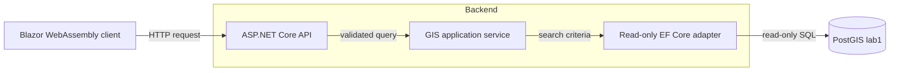

# Lab 2 handoff and evidence

The [Lab 2 specification](../lab/lab-2.md) requires a runnable repository, OpenAPI descriptions of the four GIS endpoints, observations from ten search queries, a nearby-search screenshot using the device position, a half-page architecture note, and a five-minute demonstration. This document collects the submission evidence; it does not replace the [runtime acceptance procedure](validation.md).

## Architecture note



GeoSearch separates browser interaction from geospatial querying. The Blazor WebAssembly client presents the map and search results and requests the device position only in response to the user's action. It sends search and location-sensitive requests to the ASP.NET Core API, which validates input and returns point-based GeoJSON with OpenStreetMap attribution and a dataset snapshot identifier.

Search ranking, reverse geocoding, distance filtering, and result ordering execute in PostGIS rather than in the browser. SQL query functions expose these operations to a read-only EF Core model; the API maps the database results into the HTTP contract without duplicating spatial algorithms. The restricted database login prevents application requests from changing imported data, while the separate provisioning workflow owns imports and index maintenance. A single Nginx origin serves the frontend and proxies API requests, avoiding database access or third-party geocoding from the browser.

**Measured quality attribute:** end-to-end search latency on the Hannover dataset. Record the observed latency distribution and median below before submission; unit tests alone cannot establish the lab's 300 ms target.

## Search results and latency

Open `/tests` in the browser after starting the populated deployment through Nginx. Select 5, 10, 25, or 100 requests per fixture, click **Run all**, and use **Copy evidence** to obtain a Markdown table with the actual top result, type/ID, snapshot, best/average/worst/median response latencies, and any failures. The three lab-identified ranking issues are marked in the table and in the export. Paste the measured output below, replacing the placeholders, before submission. The page sends the exact [ten fixture queries](../lab/lab-2.md#test-your-search-with-ten-fixture-queries) directly to `GET /api/search?limit=1`, independently of the map UI. It measures sequential full-body HTTP responses with `Stopwatch` in Blazor WebAssembly; it includes browser/network/proxy/TLS overhead where applicable but excludes JSON parsing, with no warm-up. The page also records total wall-clock runtime for the batch, including processing between requests. This is demo-oriented end-to-end timing, not a substitute for the dedicated benchmark harness.

Record the observed **top result**, its type or ID, and HTTP response time for each query, including results that differ from the expected answer. Use a consistent measurement method and report whether the time includes browser/network overhead or measures the API directly.

| Query | Observed top result (name, type/ID) | Median HTTP latency (ms) |
| --- | --- | --- |
| `Limmerstraße 12` | Not yet recorded | Not yet recorded |
| `Limmerstr 12 Hannover` | Not yet recorded | Not yet recorded |
| `Rathuas Linden` | Not yet recorded | Not yet recorded |
| `Linden-Mitte` | Not yet recorded | Not yet recorded |
| `Garbsen` | Not yet recorded | Not yet recorded |
| `Herrenhäuser Gärten` | Not yet recorded | Not yet recorded |
| `Lister Meile` | Not yet recorded | Not yet recorded |
| `Hauptstrasse Laatzen` | Not yet recorded | Not yet recorded |
| `Zoo Hannover` | Not yet recorded | Not yet recorded |
| `Markthalle Hannover` | Not yet recorded | Not yet recorded |

**Dataset snapshot:** Not yet recorded. **Median latency:** Not yet measured. **Measurement environment/method:** Not yet recorded.

An HTTP timing sample can be collected from the Docker host with:

```sh
curl -ksS -o /tmp/geosearch-result.json -w 'HTTP %{http_code}; total %{time_total}s\n' \
  'https://127.0.0.1:8443/api/search?q=Limmerstr%2012%20Hannover&limit=5'
```

`time_total` includes the HTTPS request through Nginx, not just the SQL query. For meaningful latency evidence, repeat each query under consistent conditions and record the selected statistic, such as the median. Do not infer measurements from offline unit tests. The instructor identifies three known ranking errors; record their actual results rather than silently changing the expected outcomes.

## Browser evidence and demo

The nearby-search screenshot must show the device position, visible map attribution, and nearby results. Save the screenshot as a repository artifact and link it here when captured. The acceptance run should also cover permission denied, unavailable location, map-centre fallback, result selection, and API error/no-results feedback. Browser geolocation requires a trustworthy secure context; [deployment](../deploy/README.md) explains how to configure local HTTPS.

Before the lab demonstration, verify that a fresh reader can follow the [repository README](../README.md), that `/swagger/v1/swagger.json` is accessible when the API runs in Development, and that the full application is available through a single browser origin. For the demo, show search, a selected map marker, Locate Me, nearby results, and the corresponding API response. Do not claim the screenshot or timing evidence is complete until the entries above are populated.
